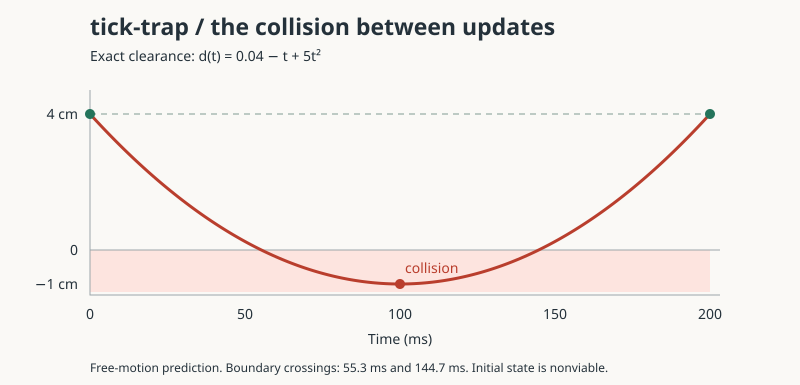

# tick-trap

Continuous-time safety analysis for sampled robot control.

tick-trap is a small research instrument for comparing sampled-state safety,
continuous-trajectory safety, and viability. It starts with analytically solvable
wall braking and planar acceleration-controlled robots. There is no claim of a
new safety controller or publication-level novelty.



The implementation uses the Python standard library and Python 3.11+. To run
without installing anything:

```sh
PYTHONPATH=src python -m unittest discover -s tests -v
PYTHONPATH=src python -m tick_trap counterexample
PYTHONPATH=src python -m tick_trap run
PYTHONPATH=src python -m tick_trap sweep --config configs/baselines.json
PYTHONPATH=src python -m tick_trap certify --config configs/planar.json
PYTHONPATH=src python -m tick_trap learn --config configs/learning.json
PYTHONPATH=src python -m tick_trap benchmark --config configs/certification.json
```

Or install with `uv sync`, then use `.venv/bin/tick-trap counterexample` and the
other commands above. A run writes JSON records, CSV metrics, a Markdown report,
and a provenance manifest under `results/`. The counterexample also produces a
standalone SVG figure. Use `--output DIRECTORY` to choose the artifact directory.

Exact rational wall trajectories reproduce the 4 cm → −1 cm → 4 cm counterexample.
Planar circle checks combine a numerical stationary-point estimate with a separate
validated Bernstein polynomial minimum enclosure. Unresolved certificates return
`unknown`; a floating-point root estimate never establishes a guarantee.

All guarantees concern the declared mathematical model and input values. They do
not cover contact dynamics, unmodelled disturbances, or physical hardware.

Six baseline/reference filters are available: unfiltered nominal input,
continuous-time CBF emulation, endpoint-only checking, Breeden's sampled-data
condition, Tan's zero-order barrier condition, and an exact wall reference.
Published methods are documented specializations, not replications of complete
published experiments. Read the [equations and assumptions](docs/methods.md) and
[experiment semantics](docs/experiments.md) before interpreting comparisons.

The stress grid varies initial feasibility, update period, actuation mismatch,
measurement noise, and fixed delay:

```sh
PYTHONPATH=src python -m tick_trap sweep --config configs/stress.json --output results/stress
```

Infeasibility stops execution explicitly. Safe completion is reported separately
from absence of an observed collision. Empirical computation timings do not
establish real-time guarantees; configured delay and measured runtime are separate.

The learning study fits an affine actuator model from noisy supervised data,
measures held-out prediction error, and runs the filters under original and
changed dynamics. Fitted parameters and all training data are saved. This is a
small model-identification experiment; prediction errors are not calibrated
uncertainty bounds.

The certification benchmark varies minimum-enclosure precision and subdivision
budget on six analytical trajectories, including tiny positive/negative margins
and a non-dyadic tangency. It records `unknown` outcomes alongside empirical cost.

See the [research plan and literature ledger](docs/research-plan.md) for the scope
of this foundation and the work required before making a research claim.

## Local commit history

This managed workspace mounts `.git` read-only for normal Git writes. The local
history is therefore stored in `.tick-trap-git`. Use the wrapper to inspect it:

```sh
sh scripts/git-local log --oneline
sh scripts/git-local status --short
```

`tick-trap-history.bundle` is a portable copy of the completed history. Outside
this restricted workspace, restore an ordinary checkout with:

```sh
git clone tick-trap-history.bundle tick-trap-restored
```
